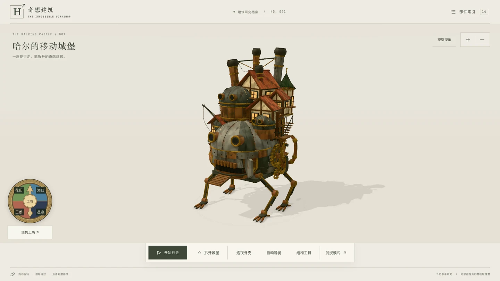
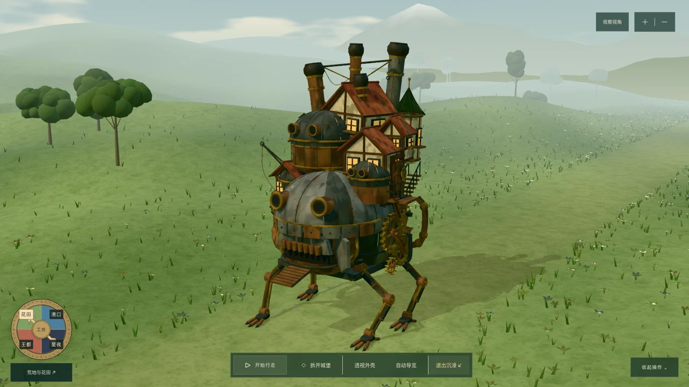
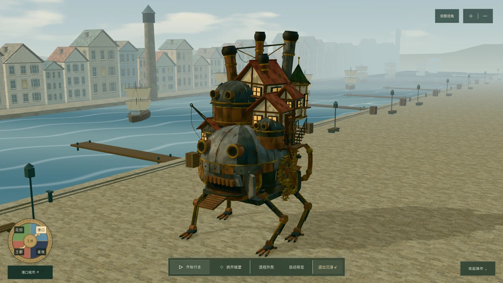
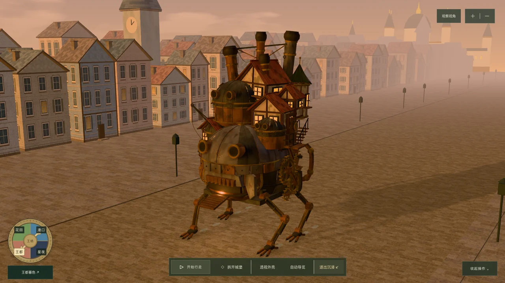
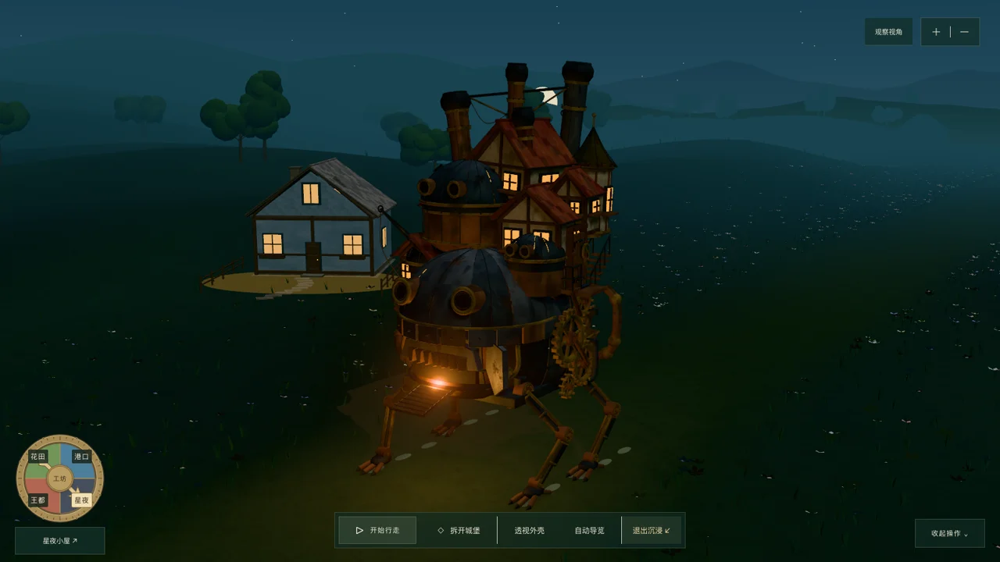
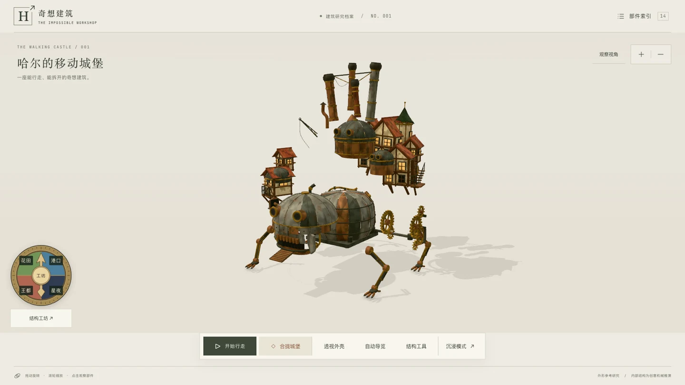
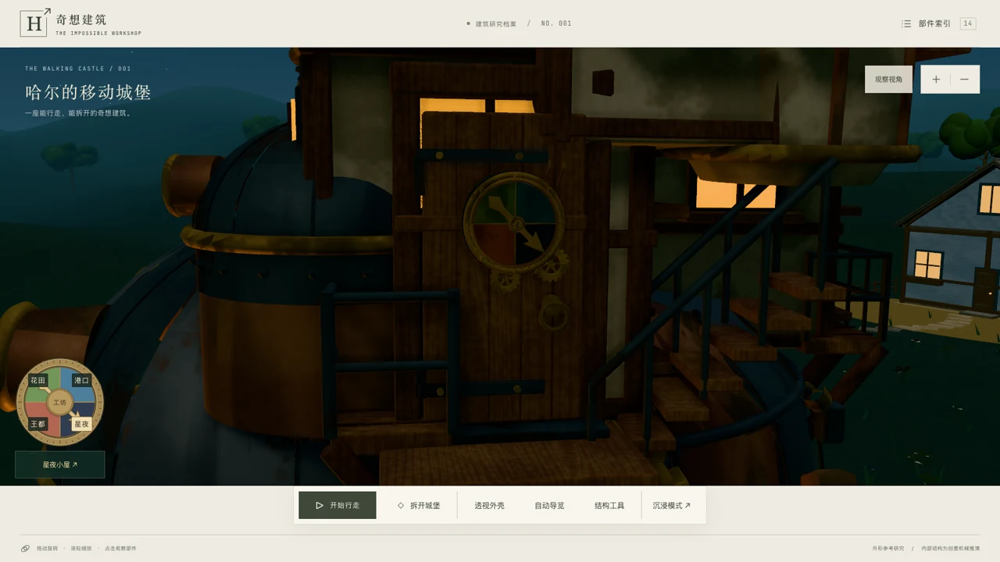

# 哈尔的移动城堡 · 奇想建筑工坊
**Howl’s Moving Castle · The Impossible Workshop**

一座可交互的 Three.js 城堡：自由绕行、四足行走、结构拆解、四色魔法门与五处目的地，以及全屏沉浸与自动导览。

An interactive castle built with Three.js: orbit freely, set its four legs in motion, explore its structure, travel between five destinations through a four-colour magic door, and enjoy immersive mode or a guided tour.

**[打开在线体验 · Explore the castle](https://bellisji233.github.io/howl-moving-castle/)**

左下四色黄铜圆盘可直接选景，中央返回工坊；屏幕指针与实体门锁同步。支持鼠标、键盘和移动屏幕，遵循系统减少动态效果设置。

Choose a destination on the brass dial at the bottom left, or press its centre to return to the workshop. Its pointer moves in sync with the dial on the castle’s door. Mouse, keyboard and mobile layouts are supported, along with the system’s reduced-motion preference.

## 城堡一览 · A look around

[](https://bellisji233.github.io/howl-moving-castle/)

自由绕行看外观，也可以让它行走、打开外壳，逐层观察这座拼接建筑。

Look around its exterior, set it walking, or open up the structure to explore the architecture layer by layer.

## 操作视频 · Video walkthrough

约 94 秒，展示结构拆解、部件隔离、透视与环境切换。点击播放器即可观看。

A 94-second recording of the teardown, part isolation, X-ray view and destination switching. Press play to watch.

https://github.com/user-attachments/assets/dd61458b-aaaa-4418-a7a2-f7cbee5d4830

录屏中的目的地栏为较早版本；当前线上体验已更新为与实体门锁同步的四色圆盘。

The recording shows an earlier destination bar. The live version now uses the four-colour dial, synchronised with the castle’s door.

## 门的另一端 · Beyond the door

<table>
  <tr>
    <td width="50%">
      
      <p><strong>荒地与花田 · Meadows</strong><br />草坡与花丛，沿着旷野前行。<br />Grassy hills and wildflowers along an open trail.</p>
    </td>
    <td width="50%">
      
      <p><strong>港口城市 · Harbour</strong><br />船只、码头与临水街区。<br />Boats, docks and streets along the water.</p>
    </td>
  </tr>
  <tr>
    <td width="50%">
      
      <p><strong>王都暮色 · Capital at dusk</strong><br />夕光穿过街道与钟楼。<br />Evening light across the streets and clock tower.</p>
    </td>
    <td width="50%">
      
      <p><strong>星夜小屋 · Starlit cottage</strong><br />冷夜色与远处的暖窗。<br />Cool night skies and the glow of distant windows.</p>
    </td>
  </tr>
</table>

## 从外壳到内部 · From the shell to the core



**可逆拆解**：房屋、烟囱、机身、足部与内部机构逐层展开，再合拢回到完整城堡。

**Reversible teardown:** separate the houses, chimneys, body, legs and internal mechanisms, then bring everything back together.



**同步门盘**：点击四色扇区选择目的地，屏幕圆盘与城堡门上的指针同步转动；中央按钮返回结构工坊。

**Synchronised dials:** select a coloured sector to change destination. The screen pointer follows the mechanism on the door; the centre button returns to the workshop.

## 本地运行 · Run locally

需要 Node.js 22.12 或更新版本。
Requires Node.js 22.12 or later.

```sh
cd howl-castle-app
npm ci
npm run dev
```

测试、生产构建与预览：
Run tests, create a production build and preview it:

```sh
npm test
npm run build
npm run preview
```

## 发布 · Deployment

推送到 `main` 后，GitHub Actions 会安装锁定依赖、运行测试、构建并发布到 GitHub Pages。构建目录为 `howl-castle-app/dist`，资源使用相对路径，支持仓库子目录访问。

Pushing to `main` triggers GitHub Actions to install locked dependencies, run tests, build the app and deploy it to GitHub Pages. The output directory is `howl-castle-app/dist`; relative asset paths support hosting under the repository’s URL.

[查看发布记录 · View deployment runs](https://github.com/bellisji233/howl-moving-castle/actions)

## 项目资料 · Project notes

以下详细记录目前主要以中文编写。
The detailed notes below are currently written mainly in Chinese.

- [详细使用说明 · Usage guide](howl-castle-app/README.md)
- [同步圆盘设计 · Dial design](docs/design/howl-castle-portal-dial.md)
- [圆盘交互与布局验证 · Dial interaction and layout checks](docs/qa-portal-dial.md)

这是程序化风格化的创意结构研究，内部机构为创意推演，不是工程动力学仿真。未内嵌电影画面、音乐或第三方城堡模型；原作形象归相应权利方。字体许可证位于 `howl-castle-app/public/fonts/`。

This is a procedural, stylised architectural study. Its internal mechanisms are imaginative interpretations rather than an engineering simulation. No film footage, music or third-party castle model is included. Rights to the original fictional imagery belong to their respective owners. Font licences are included in `howl-castle-app/public/fonts/`.
